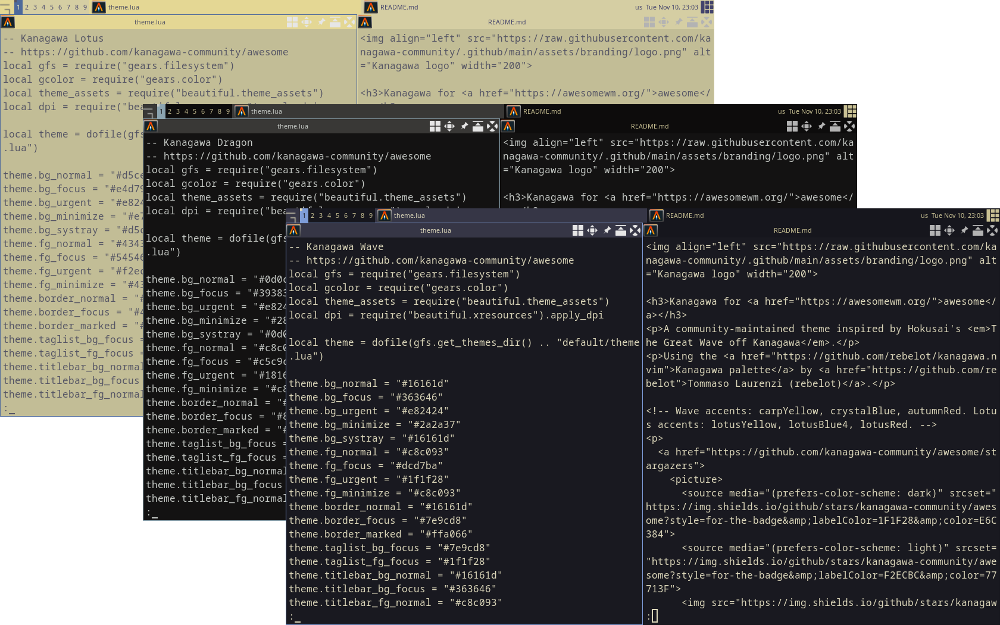
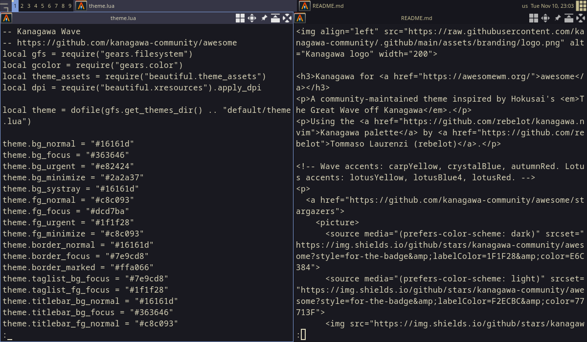
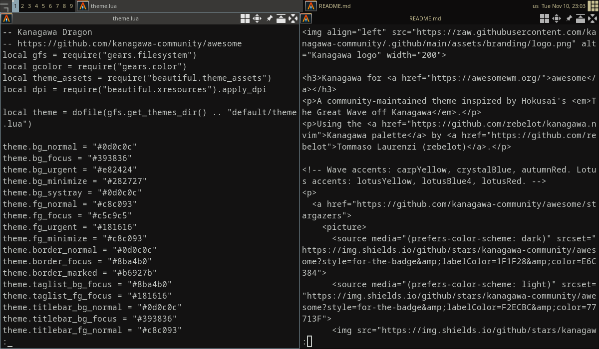
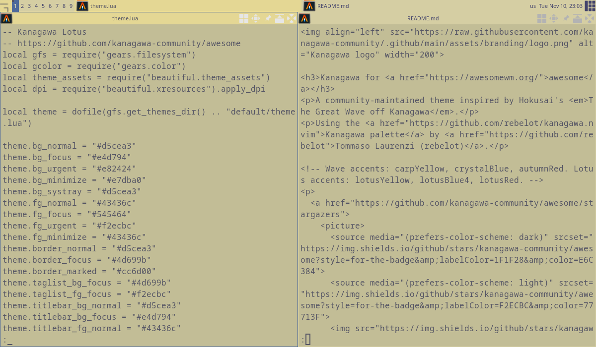

<h3>Kanagawa for <a href="https://awesomewm.org/">awesome</a></h3>
<p>A community-maintained theme inspired by Hokusai's <em>The Great Wave off Kanagawa</em>.</p>
<p>Using the <a href="https://github.com/rebelot/kanagawa.nvim">Kanagawa palette</a> by <a href="https://github.com/rebelot">Tommaso Laurenzi (rebelot)</a>.</p>

<!-- Wave accents: carpYellow, crystalBlue, autumnRed. Lotus accents: lotusYellow, lotusBlue4, lotusRed. -->
<p>
  <a href="https://github.com/kanagawa-community/awesome/stargazers">
    <picture>
      <source media="(prefers-color-scheme: dark)" srcset="https://img.shields.io/github/stars/kanagawa-community/awesome?style=for-the-badge&amp;labelColor=1F1F28&amp;color=E6C384">
      <source media="(prefers-color-scheme: light)" srcset="https://img.shields.io/github/stars/kanagawa-community/awesome?style=for-the-badge&amp;labelColor=F2ECBC&amp;color=77713F">
      
    </picture>
  </a>
  <a href="https://github.com/kanagawa-community/awesome/releases/latest">
    <picture>
      <source media="(prefers-color-scheme: dark)" srcset="https://img.shields.io/github/v/release/kanagawa-community/awesome?style=for-the-badge&amp;label=release&amp;labelColor=1F1F28&amp;color=7E9CD8">
      <source media="(prefers-color-scheme: light)" srcset="https://img.shields.io/github/v/release/kanagawa-community/awesome?style=for-the-badge&amp;label=release&amp;labelColor=F2ECBC&amp;color=4D699B">
      
    </picture>
  </a>
  <a href="https://github.com/kanagawa-community/awesome/issues">
    <picture>
      <source media="(prefers-color-scheme: dark)" srcset="https://img.shields.io/github/issues/kanagawa-community/awesome?style=for-the-badge&amp;labelColor=1F1F28&amp;color=C34043">
      <source media="(prefers-color-scheme: light)" srcset="https://img.shields.io/github/issues/kanagawa-community/awesome?style=for-the-badge&amp;labelColor=F2ECBC&amp;color=C84053">
      
    </picture>
  </a>
</p>

<br clear="both">
<br>

## Previews



<details>
<summary>🌊 Wave</summary>

</details>

<details>
<summary>🐉 Dragon</summary>

</details>

<details>
<summary>🪷 Lotus</summary>

</details>

## Requirements

- awesome 4.3 or later.

## Installation

Download the three themes into ~/.config/awesome/themes:

```sh
for variant in wave dragon lotus; do
  mkdir -p ~/.config/awesome/themes/kanagawa-$variant
  curl -fsSL -o ~/.config/awesome/themes/kanagawa-$variant/theme.lua https://raw.githubusercontent.com/kanagawa-community/awesome/main/themes/kanagawa-$variant/theme.lua
done
```

Or clone the repository and run `./install.sh`. It installs all three variants,
or only the ones you name, for example `./install.sh dragon lotus`. `./uninstall.sh`
takes the same names and removes them.

## Usage

Load a theme in `~/.config/awesome/rc.lua`, in place of the default theme:

```lua
beautiful.init(gears.filesystem.get_configuration_dir() .. "themes/kanagawa-wave/theme.lua")
```

The theme starts from awesome's default theme, so fonts and icons stay the
same, and recolors the icons with the theme's colors.

## Palette

Every color comes from the shared
[palette](https://github.com/kanagawa-community/.github/blob/main/docs/PALETTE.md),
picked by role, so each variant uses its own value for the same role.

| awesome color                                                    | Palette role          |
| ---------------------------------------------------------------- | --------------------- |
| `bg_normal`, `bg_systray`, `border_normal`, `titlebar_bg_normal` | `ui.bg_m3`            |
| `bg_focus`, `titlebar_bg_focus`                                  | `ui.bg_p2`            |
| `bg_minimize`                                                    | `ui.bg_p1`            |
| `fg_normal`, `fg_minimize`, `titlebar_fg_normal`                 | `ui.fg_dim`           |
| `fg_focus`, `titlebar_fg_focus`                                  | `ui.fg`               |
| `bg_urgent`, `fg_urgent`                                         | `diag.error`, `ui.bg` |
| `border_focus`, `taglist_bg_focus`                               | `syn.fun`             |
| `border_marked`                                                  | `syn.constant`        |
| `tooltip_*`, `notification_*`, `hotkeys_*`                       | `ui.float.*`          |
| `menu_*`                                                         | `ui.pmenu.*`          |
| `wallpaper_bg`                                                   | `ui.bg`               |

## Credits

This port replaces the awesome theme in the `extras` folder of the
[Neovim plugin](https://github.com/kanagawa-community/neovim). Kamiel de Visser first contributed that theme to kanagawa.nvim. The
colors come from [kanagawa.nvim](https://github.com/rebelot/kanagawa.nvim) by
Tommaso Laurenzi.

## Issues and contributions

Report bugs and request changes in this port's
[issue tracker](https://github.com/kanagawa-community/awesome/issues). Contributions are welcome.

See [CONTRIBUTING.md](CONTRIBUTING.md) before opening a pull request.

## License

MIT. See [LICENSE](LICENSE).
